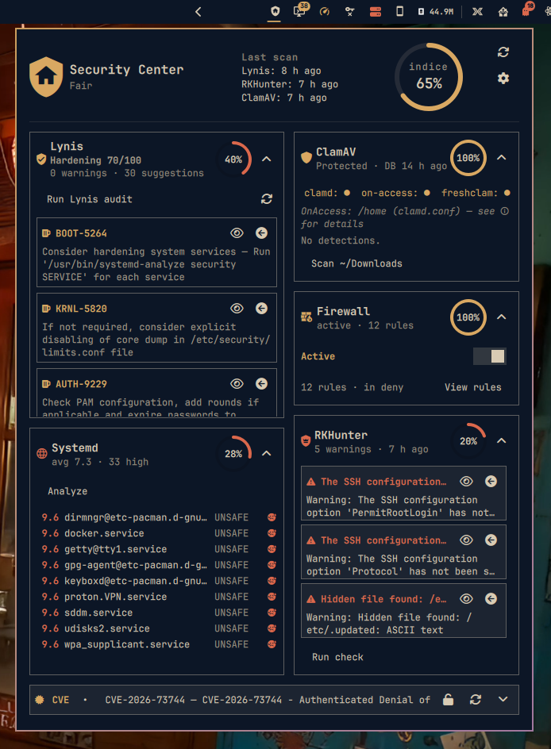

# Security Center

Unified security posture dashboard for [Omarchy](https://omarchy.org) Quattro — one bar icon, one panel, five scanners + CVE ticker.

- **Global indice 0–100** `SecGauge` (`indice` / `65%`): UFW 25 + ClamAV 25 + Lynis 25 + RKHunter 25 (systemd shown as second indice, not counted in global)
- **Two-column layout** — `Lynis` large left (`Hardening 70/100`, `warnings`/`suggestions` scrollable, `Open` details + `Google`/`CIS Docs` + `Ignore`), `Systemd` below it (avg exposure, `exposure/predicate` list, `SmallGauge`, height = `RKHunter`), `ClamAV` / `Firewall` / `RKHunter` stacked right (48px gauges, `View rules` scrollable, `Run check` less verbose)
- **CVE ticker** — `cvefeed.io/rssfeed/latest.xml` marquee (hover to pause, Linux filter `󰚊`), details collapsed by default
- **Exceptions** per finding → `~/.config/omarchy/security-center/exceptions.json` (user-writable, never committed)

No data leaves the machine except the optional CVE RSS fetch (6 s timeout, 200 KB cap, toggleable).

## Preview



## Install

```bash
omarchy plugin add https://github.com/tug-benson/omarchy-security-center --enable
```

Symlink for local development:

```bash
ln -s /path/to/omarchy-security-center ~/.config/omarchy/plugins/io.github.tug-benson.security-center
omarchy-shell shell rescanPlugins
```

Remove:

```bash
omarchy plugin remove io.github.tug-benson.security-center
```

## Dependencies

| Tool | Package | Notes |
|------|---------|-------|
| UFW | `ufw` | Stocks on Omarchy; panel reads `/etc/ufw/*` without privilege |
| ClamAV | `clamav` `clamav-daemon` | `clamav-freshclam` for DB updates; `OnAccessIncludePath /home` in `/etc/clamav/clamd.conf` |
| Lynis | `lynis` | `lynis audit system --quick` to populate `/var/log/lynis.*` (640, see Privilege) |
| RKHunter | `rkhunter` | `rkhunter --propupd` then `rkhunter --check --sk --report-warnings-only` |
| systemd | `systemd` | `systemd-analyze security` (no privilege, JSON) |
| CVE feed | network | Optional; disable with `cveEnabled: false` |

```bash
pacman -S ufw clamav lynis rkhunter
# or
yay -S ufw clamav lynis rkhunter
freshclam
lynis audit system --quick
rkhunter --propupd
```

## Privilege — when the panel asks for auth

The panel is **read-only without privilege**. Elevation is requested only when you explicitly trigger a privileged action (all via absolute paths, no `PATH` lookup):

- **UFW toggle / reload** — `UfwController.qml` via `/usr/bin/pkexec /usr/sbin/ufw` (or `terminal` mode `sudo` if you set `elevation: terminal`). Reading `/etc/ufw/*` is world-readable, no auth.
- **Lynis audit** — button `Run Lynis audit` runs `sudo lynis audit system --quick` in a floating terminal (`omarchy-launch-floating-terminal-with-presentation`), prompts for `sudo` password in the terminal.
- **Lynis logs unreadable (640)** — banner `Fix permissions` runs `pkexec chmod 644 /var/log/lynis.log /var/log/lynis-report.dat` (polkit dialog). Without this, `Hardening` stays `No permission` and suggestions are hidden. The fix is one-time per audit; Lynis recreates logs `640` on next audit.
- **ClamAV scan** — `Scan ~/Downloads` / `Scan Home` runs `clamscan -r --infected <path>` in a floating terminal **as your user**, no `sudo` for `~/` paths. Scanning system paths would require manual `sudo` but the shortcuts use `~/` / `xdg-user-dir` with fallback to `$HOME`.
- **RKHunter check** — `Run check` runs `sudo rkhunter --check --sk --report-warnings-only --no-verbose-logging` in a floating terminal (sudo prompt).
- **Systemd analyze** — `Analyze` button runs `systemd-analyze security --no-pager` in a floating terminal, no privilege.
- **CVE fetch** — `scripts/cve-feed.py` uses `urllib` with `User-Agent: omarchy-security-center/0.1`, 6 s timeout, 200 KB cap.

No action is taken automatically; every `pkexec`/`sudo` is behind an explicit click.

## How it works

- `scripts/security-center.py` aggregates UFW/ClamAV/Lynis/RKHunter/systemd in one pass, bounds output to 64 KB, sanitizes text (`sanitize()`), respects `exceptions.json`, computes `systemd` `avgExposure` → `25 - avg*2.5` and `high` count.
- `scripts/cve-feed.py` fetches `https://cvefeed.io/rssfeed/latest.xml` (truncated, Linux filter `linux|kernel|ubuntu|debian|…`).
- `UfwController.qml` watches `/etc/ufw/*` via `FileView` and elevates only `enable/disable/reload`.
- `Panel.qml` renders `SecGauge` (`indice` / `%`), two-column `Lynis+Systemd` / `ClamAV+UFW+RKHunter`, ticker marquee, and detail overlay (`Open` → `Copy`/`Google`/`CIS Docs`/`Ignore`/`Close`).

## Configure

In `Settings → Plugins → Security Center` or `~/.config/omarchy/shell.json`:

- `refreshIntervalSec` (60–3600) — background poll; panel polls faster while open.
- `cveEnabled` / `cveMaxItems` — toggle and cap CVE fetches (ticker remains, details collapsed by default).
- `clamavScanPaths` — comma-separated shortcuts for `clamscan` (default `~/Downloads`).
- `lynisShowAll` — show suggestions even when warnings exist.

Ignored findings live in `~/.config/omarchy/security-center/exceptions.json`:

```json
{ "lynis": ["AUTH-9229"], "rkhunter": ["The SSH configuration option 'PermitRootLogin' has not been set."] }
```

Edit or delete to un-ignore. The file is user-writable and never committed. `egrep`/`fgrep`/`ldd` script wrappers are ignored by default for Arch.

## Acknowledgements

- UFW parsing and firewall UX from [srozen/omarchy-ufw](https://github.com/srozen/omarchy-ufw) (MIT) — `Model.js` and `UfwController.qml` are derived from that project's MIT-licensed code.
- ClamAV status from [szentesg/omarchy-clamav-monitor](https://github.com/szentesg/omarchy-clamav-monitor) (MIT)
- Plugin health scanner from [ucmz851/omasecurity](https://github.com/ucmz851/omasecurity) (MIT)
- Omarchy shell docs: <https://plugins.omarchy.org/develop.html> and Quickshell <https://doc.qt.io/qt-6/modules-qml.html>, Nerd Fonts <https://www.nerdfonts.com/cheat-sheet>

## Third-party license notices

The following MIT-licensed code is reused in this plugin. Original copyright and permission notices are retained here per the MIT license terms:

### srozen/omarchy-ufw (MIT)

```
MIT License

Copyright (c) srozen

Permission is hereby granted, free of charge, to any person obtaining a copy
of this software and associated documentation files (the "Software"), to deal
in the Software without restriction, including without limitation the rights
to use, copy, modify, merge, publish, distribute, sublicense, and/or sell
copies of the Software, and to permit persons to whom the Software is
furnished to do so, subject to the following conditions:

The above copyright notice and this permission notice shall be included in all
copies or substantial portions of the Software.

THE SOFTWARE IS PROVIDED "AS IS", WITHOUT WARRANTY OF ANY KIND, EXPRESS OR
IMPLIED, INCLUDING BUT NOT LIMITED TO THE WARRANTIES OF MERCHANTABILITY,
FITNESS FOR A PARTICULAR PURPOSE AND NONINFRINGEMENT. IN NO EVENT SHALL THE
AUTHORS OR COPYRIGHT HOLDERS BE LIABLE FOR ANY CLAIM, DAMAGES OR OTHER
LIABILITY, WHETHER IN AN ACTION OF CONTRACT, TORT OR OTHERWISE, ARISING FROM,
OUT OF OR IN CONNECTION WITH THE SOFTWARE OR THE USE OR OTHER DEALINGS IN
THE SOFTWARE.
```

## License

MIT — see [LICENSE](LICENSE).
